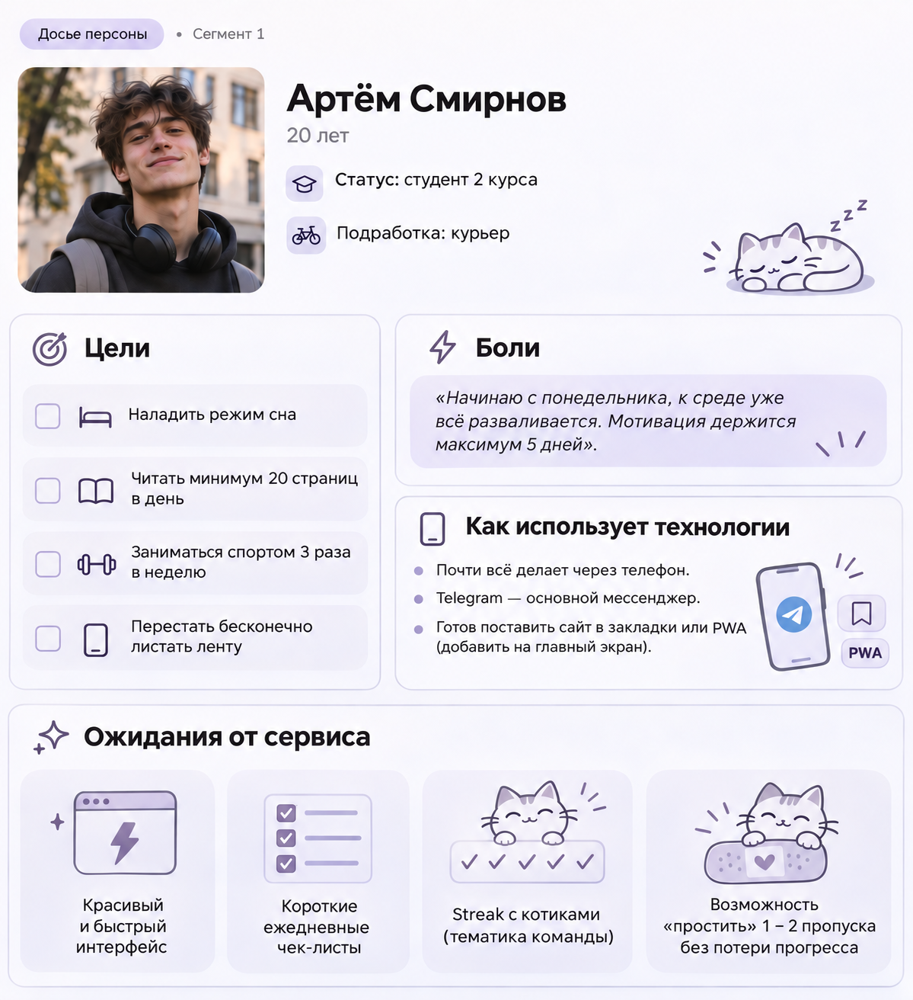
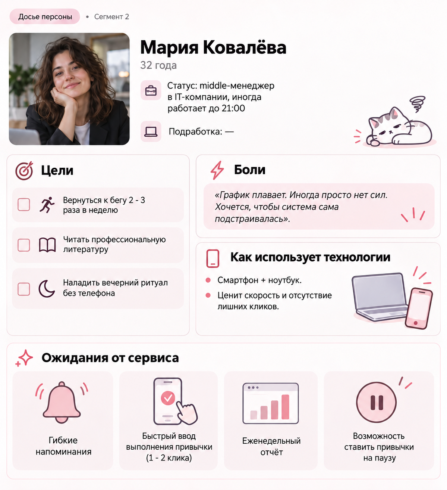
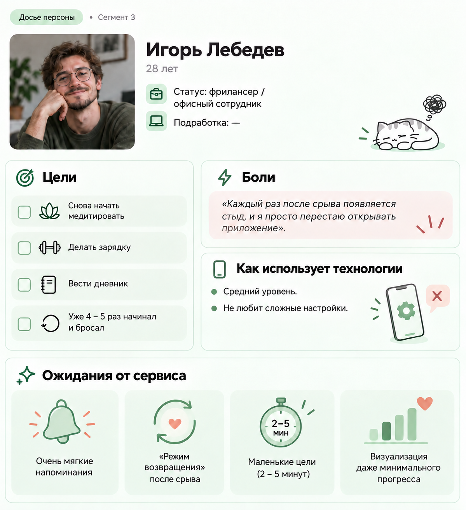

# МИНИСТЕРСТВО НАУКИ И ВЫСШЕГО ОБРАЗОВАНИЯ РОССИЙСКОЙ ФЕДЕРАЦИИ
**ГОСУДАРСТВЕННОЕ ОБРАЗОВАТЕЛЬНОЕ УЧРЕЖДЕНИЕ ВЫСШЕГО ОБРАЗОВАНИЯ**  
**«РЯЗАНСКИЙ ГОСУДАРСТВЕННЫЙ РАДИОТЕХНИЧЕСКИЙ УНИВЕРСИТЕТ ИМ. В. Ф. УТКИНА»**

Кафедра ВПМ  
Дисциплина: «Введение в профессиональную деятельность»

---

### Отчет по самостоятельной работе №3
**Тема:** «Определение целевой аудитории»

**Проект:** Сервис формирования здоровых привычек  
**Команда:** «Котики за ЗОЖ»  
**Состав команды:**
- **Бурсиков Е.И.** — руководитель разработки
- **Еруков А.А.** — архитектор ПО
- **Ершова А.Ю.** — программист
- **Гончаров М.Р.** — исследователь
- **Буланенко Д.Г.** — специалист по данным
- **Шибаршина Д.В.** — специалист по тестированию

---

## 1. Определение целевой аудитории и ключевые сегменты

### 1.1. Широкий спектр потенциальных пользователей
Сервис потенциально интересен всем, кто хочет сформировать или вернуть полезные привычки:
- Школьники старших классов и студенты
- Работающие специалисты любого возраста
- Молодые родители
- Люди после 40–50 лет, желающие вернуть контроль над здоровьем
- Люди с хронической прокрастинацией или синдромом выгорания
- Те, кто уже пробовал приложения-трекеры, но бросал их

### 1.2. Ключевые сегменты
Мы выделили три ключевых сегмента. Они покрывают основной спектр болей и позволяют сфокусировать MVP сайта.

| № | Сегмент | Возраст | Почему ключевой |
|---|---|---|---|
| 1 | Студенты и молодые люди, которые хотят организовать свою жизнь | 16–24 года | Самая массовая и активная аудитория. Высокая мотивация на старте + сильная прокрастинация. Легко привлекаются через вузы и соцсети. |
| 2 | Работающие люди, стремящиеся к саморазвитию | 23–40 лет | Платёжеспособная аудитория. Готовы платить за экономию времени и результат. Основной источник удержания продукта. |
| 3 | Люди, которым трудно поддерживать регулярность | 18–45 лет | Пересекается с 1 и 2, но имеет специфическую боль «я уже бросал». Критичны напоминания, маленькие цели и визуализация прогресса. |

> Эти три сегмента дают 80–85% потенциальной аудитории на этапе запуска.  
> **Сегмент 3 — «сквозной»:** он описывает поведенческую проблему, а не только демографию, поэтому помогает проектировать ключевые механики (напоминания, streak, маленькие шаги).

---

## 2. Подробная характеристика сегментов

| Характеристика | Сегмент 1. Студенты | Сегмент 2. Работающие | Сегмент 3. «Бросальщики» |
|---|---|---|---|
| **Возраст** | 16–24 года | 23–40 лет | 18–45 лет |
| **Уровень владения техникой** | Высокий (уверенно пользуются смартфоном, браузером, Telegram). Ожидают современный UI. | Средний — высокий. Ценят простоту и скорость. | Средний. Могут уставать от сложных интерфейсов. |
| **Контекст использования** | Между парами, вечером дома, в транспорте, перед сном. Часто с телефона. | Утром до работы, в обеденный перерыв, вечером после 20:00. Иногда с рабочего компьютера. | В моменты «надо бы начать», вечером, когда появляется чувство вины. |
| **Основные потребности** | Простой старт, видимый прогресс, геймификация, социальная поддержка, короткие сессии. | Экономия времени, интеграция с календарём, гибкость под нестабильный график, отчёты. | Мягкие напоминания, очень маленькие цели, защита от срыва, визуализация прогресса. |
| **Основные проблемы** | Прокрастинация, резкое падение мотивации через 3–7 дней, мышление «всё или ничего». | Высокая загруженность, нестабильный график, ощущение «нет времени даже на 10 минут». | Повторные неудачи → потеря веры в себя, стыд, избегание трекеров. |
| **Техническая оценка (архитектор ПО)** | Можно делать PWA + push. Высокая толерантность к новым интерфейсам. | Нужна быстрая загрузка. | Интерфейс должен быть максимально простым и «прощающим». |
| **Риски тестирования** | Бросают, если нет быстрых побед и красивой визуализации. | Бросают, если напоминания приходят в неудобное время. | Бросают при любом ощущении давления или сложного онбординга. |
| **Потребности в данных** | Статистика streak, микро-цели, сравнение с друзьями. | Время выполнения привычек, корреляция с загруженностью, weekly report. | История попыток, % возвратов после срыва, «дни без вины». |

---

## 3. Детальные портреты пользователей (User Persona)

### Персона 1 — Артём, 20 лет (Сегмент 1)

### Персона 2 — Мария, 32 года (Сегмент 2)

### Персона 3 — Игорь, 28 лет (Сегмент 3)

---

## 4. Единое видение целевой аудитории для всей команды

Мы делаем сервис для людей, которые хотят изменить свою жизнь через маленькие регулярные действия, но регулярно сталкиваются с прокрастинацией, потерей мотивации и срывами.

**Главный фокус MVP:**
- Максимально простой и быстрый старт.
- Механики, которые помогают возвращаться после срыва, а не только «не срываться».
- Визуализация прогресса + мягкая поддержка (визуальный «огонёк» (`streak-flame`) в стиле Duolingo/TikTok — простая и сильная механика удержания, особенно для студентов и тех, кто часто бросает).
- Гибкость под нестабильный график.

> Все решения по интерфейсу, напоминаниям, онбордингу и аналитике мы проверяем через призму трёх персон: **Артёма, Марии и Игоря**.

---

## 5. Дополнительные материалы и ссылки

* 🔗 **[Опрос о потребностях пользователей в сервисе](https://docs.google.com/forms/d/e/1FAIpQLSe436Uxg5DIzKQL5f24jd2XoOI6hE-Oj28VWxP2W-ET5laj1g/viewform?usp=header)**
* 📊 **[Результаты опроса (Таблица)](https://docs.google.com/spreadsheets/d/1ySmMUYHBjkj8ECXD6tkmkfGUmiWtmQ1qOjelUfEBYmc/edit?usp=sharing)**
